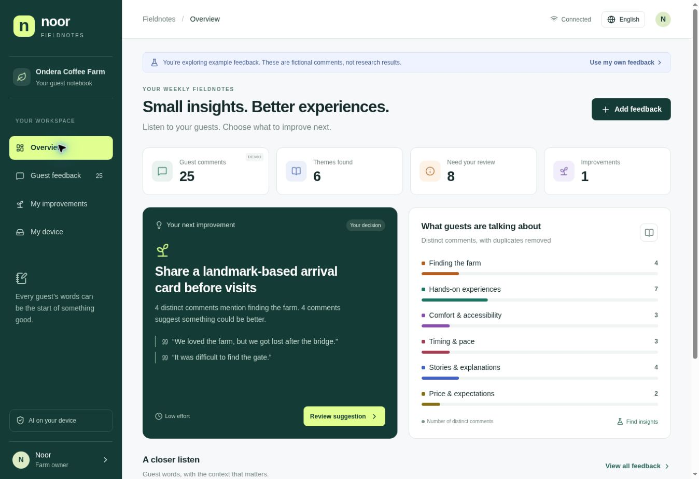

# FarmPilot

A local AI assistant that helps a small tourism operator turn visitor feedback into a reviewed improvement plan, while preserving the original evidence and keeping decisions with the operator.

**Prototype · World Bank Small AI for Development Hackathon, Track C: Tourism**

[Open the static demo](https://farm-pilot-five.vercel.app/offline/index.html) · [Full technical report](docs/TECHNICAL_REPORT.md) · [Model and data card](docs/model-data-card.md)



## The workflow

**Visitor feedback → local analysis → original evidence → human correction → approved plan → recorded observation.**

The operator reviews recurring themes, checks the supporting comments, corrects mistakes and approves an improvement. The visitor side supports approved business facts and controlled visit requests. A request becomes a confirmed booking only after an operator quote and the visitor's acceptance.

## Run the included demo

The repository includes a prebuilt browser demo. From its root:

```sh
python3 -m http.server 8080 --bind 127.0.0.1 --directory public
```

On Windows, use `py -m http.server 8080 --bind 127.0.0.1 --directory public`.

Open **http://localhost:8080/offline/index.html**. Serve over HTTP; opening the HTML with `file://` does not supply the required browser environment.

This route requires no Node installation or API keys. It serves the included assets locally. The compact feedback model is available in the core; use **My device** to prepare the full feedback package and wait for readiness before testing offline semantic analysis. Local demo requests do not create authoritative online bookings.

Optional translation weights are distributed separately. The repository's full feedback demo does not require those packs. See the [translation card](docs/translation-data-card.md) and [model distribution instructions](docs/PUBLISH.md).

## Where to look in the code

| Area | Entry point | Review focus |
| --- | --- | --- |
| Operator interface | [app/tourism.tsx](app/tourism.tsx) | Feedback review, saved plans and operator controls |
| Workflow rules | [lib/workflow.ts](lib/workflow.ts) | Quote revisions, explicit acceptance, consent and capacity checks |
| Feedback analysis | [lib/engine.ts](lib/engine.ts) | Local classification, uncertainty and supporting evidence |
| Connected service | [lib/server.ts](lib/server.ts) | Operator access, private visitor keys and persistent booking actions |
| Model/data evidence | [Technical report](docs/TECHNICAL_REPORT.md), [model card](docs/model-data-card.md) | Sources, synthetic datasets, evaluation and limitations |
| Static distribution | [scripts/build-static.mjs](scripts/build-static.mjs) | Hash verification of prebuilt assets before packaging |

The stack includes React/TypeScript, local ONNX inference, service-worker caching and an optional Cloudflare Worker/D1 service. The full source toolchain uses Vinext/Vite; do not assume this is a standard `next dev` project.

## Team and contributions

**Jiwoo Jung:** researcher and frontend designer; studied the scenario's connectivity, shared-device and feedback constraints and worked on the frontend experience.

**Kelvin:** backend designer; designed the logic/data flow connecting analysis, saved decisions and improvement plans.

These roles preserve the existing project attribution. The repository is a team project; code ownership beyond these recorded roles should be established from contributions rather than inferred from the repository owner.

## Develop and check

Use **Node 24** for the complete test suite and the pnpm version pinned in [package.json](package.json).

```sh
pnpm install --frozen-lockfile
pnpm dev
```

Useful existing checks:

```sh
pnpm test:workflow
pnpm test:service
pnpm test:ai
pnpm test:desktop
pnpm exec tsc --noEmit
pnpm lint
pnpm build
```

To package the existing prebuilt static demo without installing JavaScript dependencies:

```sh
node scripts/build-static.mjs
```

The output is `static/`. Run translation/archive checks only after supplying the optional language packs. Test scripts may refresh tracked validation reports; inspect those changes before committing. Connected-service configuration and the complete reproduction commands are in the [technical report](docs/TECHNICAL_REPORT.md#run-develop-and-reproduce).

## Current limits

- The scenario, default business, rates and bundled visitor comments are fictional. Synthetic/development tests do not establish field impact.
- The semantic feedback model is reused; the compact fallback uses a small synthetic training set. Review errors and abstentions before using results.
- Translation can change names, times and amounts. Native-language review and target-phone performance validation remain outstanding.
- Browser records and backups are unencrypted; use fictional information for a shared-device demonstration.
- Offline demo bookings, optional connected-service behavior and native installer validation have different requirements. This README does not claim deployment, submission acceptance or field validation.

The [full report](docs/TECHNICAL_REPORT.md) retains the original evaluation tables, dataset provenance, challenge mapping, licensing and limitations. Historical evaluation results there are identified as development evidence; they are not new measurements from this documentation cleanup.

## License

Application code: [MIT](LICENSE). Models, datasets and third-party runtime components retain their own [licenses and notices](LICENSES/) and the attributions recorded in the technical report.
